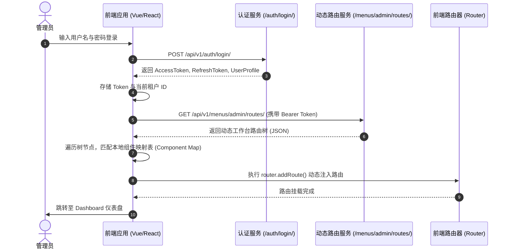

# 附录 06：前端与后端接口全景对接方案与实践指南（Frontend API Integration Guide）

本文档专为前端工程研发团队编写，基于 `lipeaks_backend` 系统的 RESTful API 规范、底层安全中间件、多租户隔离防护与 Redis 缓存架构，提供一套**可直接投入生产级开发的前端对接全景方案**。

方案兼顾：
1. **通用现代化架构底座**：基于 TypeScript + Axios 构建，具备双身份 JWT 拦截、Token 无感静默刷新、多租户自动注入、Redis 全局缓存穿透感知与统一错误捕获。
2. **管理后台专属工程化**：深入 RBAC 权限矩阵、动态路由生成与挂载、按钮级权限指令与租户组织中台。
3. **终端业务分模块实践**：覆盖 21 天自律打卡、CMS 内容创作、商业 License 授权、积分商城、微信生态、工单与 CRM 等 11 大核心模块。

---

## 一、全局通讯协议与核心交互机制（First Principles）

### 1.1 统一响应结构（Unified Response Wrapper）
系统在后端底层挂载了专属的统一响应中间件 `ResponseStandardizationMiddleware`（`common/middleware/response_standardization_middleware.py`）与全局异常处理器 `custom_exception_handler`（`common/exceptions/handler.py`）。
除文件下载、流式代理反代（如微信图片代理）或公开 HTML 页面外，**所有 API 响应均被强制自动封装为标准的统一数据包**：

```typescript
// 通用业务响应载荷 (Strict Backend Contract)
export interface ApiResponse<T = any> {
  success: boolean;       // 请求是否真正成功：true 为成功，false 为业务或系统异常
  code: number;          // 业务状态码：2000 表示成功，非 2000 为具体异常码
  message: string;       // 人类可读的操作提示（如 "操作成功"、"请求参数错误"）
  data: T;               // 核心业务载荷（实体对象、数组，或含 count/results 的分页数据）
  error_code?: string;   // 异常类型编码字符串（如 "PERMISSION_DENIED"、"VALIDATION_ERROR"）
  error?: string | null; // 调试异常堆栈或诊断细节
}

// 分页列表通用响应载荷（嵌套在 ApiResponse.data 内）
export interface PageResult<T> {
  count: number;         // 符合条件的总记录条数
  next: string | null;   // 下一页绝对 URL（若有）
  previous: string | null; // 上一页绝对 URL（若有）
  results: T[];          // 当前页业务数据数组
}
```

#### 常见业务状态码语义速查：
| 状态码 (`code`) | HTTP 状态码 | 业务含义 | 前端建议处理动作 |
| :--- | :--- | :--- | :--- |
| **`2000`** | 200 OK / 201 Created | 操作成功 | 正常解包 `response.data.data` |
| **`4001`** | 400 Bad Request | 客户端入参验证失败 | 表单级标红提示或全局轻提示 `message.warning` |
| **`4002`** | 401 Unauthorized | Token 缺失、伪造或完全过期 | 触发登出逻辑，清空本地存储并重定向至登录页 |
| **`4003`** | 403 Forbidden | 权限不足或被租户隔离拦截 | 弹出权限不足警告，或重定向至 403 页面 |
| **`4004`** | 404 Not Found | 访问的实体对象不存在 | 提示资源不存在或列表移除项 |
| **`4005`** | 409 Conflict | 业务状态冲突（如机器码已绑定） | 引导用户解绑或重试 |
| **`5000`** | 500 Internal Error | 后端未捕获的系统内部异常 | 弹出全局错误提示 `系统繁忙，请稍后重试` |

---

### 1.2 多租户隔离防护（Tenant Isolation Header）
系统绝大部分业务接口受 `TenantMiddleware` 拦截保护：
- **请求头规范**：前端必须在 HTTP Headers 中附带：
  ```http
  X-Tenant-Id: <tenant_uuid_or_id>
  ```
- **租户 Header 规则矩阵**：
  1. **免头路由（AllowAny/Public）**：登录接口 `/api/v1/auth/login/`、Token 刷新 `/api/v1/auth/refresh/`、微信授权、许可激活验证；
  2. **强制隔离路由（Tenant-Isolated）**：`/api/v1/check-system/*`、`/api/v1/cms/*`、`/api/v1/points/*`、`/api/v1/rbac/*`、`/api/v1/customers/*` 等，**未传或传入不存在的租户 ID 将直接返回 400 / 403 阻断**；
  3. **超管全局路由**：`/api/v1/admin/users/`、`/api/v1/tenants/` 由超级管理员跨租户管理，无需限制单租户。

---

### 1.3 双身份认证体系（Dual-Identity Authentication）
系统区分两类用户主体：
- **管理端主体（Staff / Admin User）**：具备后台管理权限，通过后台系统登录。
- **租户端主体（Member User）**：终端业务使用者（如打卡学员、CMS 创作者），属于某一具体租户。
两者登录后均签发标准 JWT，包含 `access` 与 `refresh` 双 Token。
请求时统一在请求头中携带：
```http
Authorization: Bearer <access_token>
```

---

### 1.4 Redis 全局 API 缓存与强制穿透交互
后端已全面挂载 Redis 二级缓存中间件（针对 GET 幂等请求）：
- **缓存状态感知**：检查响应头中的 `X-Cache`：
  - `X-Cache: HIT`：来自 Redis 缓存（响应时间通常 < 15ms）；
  - `X-Cache: MISS`：穿透至数据库查询并回填 Redis。
- **前端强刷策略（Cache-Busting）**：
  在用户主动点击“刷新列表”、“重置过滤条件”或表单提交成功后的回调拉取中，前端可通过以下任一方式强制绕过缓存获取实时数据：
  1. **Header 方式（推荐）**：请求头增加 `Cache-Control: no-cache`；
  2. **Query 方式**：URL 后追加参数 `?nocache=1`。

---

## 二、通用前端网络层架构设计（TypeScript + Axios 完整实现）

本节提供可直接落地的模块化网络层封装，内置：
1. **多租户与 Token 自动注入**；
2. **并发请求下的 Token 无感静默刷新队列（Mutex Lock）**；
3. **缓存穿透开关封装**；
4. **统一错误码拦截与解包**。

### 2.1 基础类型定义：`src/api/types.ts`
```typescript
// src/api/types.ts

// 统一标准后端响应
export interface ApiResponse<T = any> {
  success: boolean;
  code: number;
  message: string;
  data: T;
  error_code?: string;
  error?: string | null;
}

// 分页结构
export interface PageResult<T> {
  count: number;
  next: string | null;
  previous: string | null;
  results: T[];
}

// 分页查询通用入参
export interface PageQuery {
  page?: number;
  page_size?: number;
  search?: string;
  ordering?: string;
  [key: string]: any;
}

// JWT 凭据模型
export interface AuthTokens {
  access: string;
  refresh: string;
}

// 扩展 AxiosRequestConfig，支持穿透缓存标记
declare module 'axios' {
  export interface AxiosRequestConfig {
    /** 是否强制穿透 Redis 缓存拉取最新数据 */
    noCache?: boolean;
    /** 是否跳过全局错误通知（交由业务自身 catch 处理） */
    silentError?: boolean;
  }
}
```

---

### 2.2 状态持久化管理：`src/utils/auth-storage.ts`
```typescript
// src/utils/auth-storage.ts

const ACCESS_TOKEN_KEY = 'lipeaks_access_token';
const REFRESH_TOKEN_KEY = 'lipeaks_refresh_token';
const TENANT_ID_KEY = 'lipeaks_current_tenant_id';
const USER_INFO_KEY = 'lipeaks_user_profile';

export const authStorage = {
  getAccessToken: (): string => localStorage.getItem(ACCESS_TOKEN_KEY) || '',
  setAccessToken: (token: string) => localStorage.setItem(ACCESS_TOKEN_KEY, token),
  
  getRefreshToken: (): string => localStorage.getItem(REFRESH_TOKEN_KEY) || '',
  setRefreshToken: (token: string) => localStorage.setItem(REFRESH_TOKEN_KEY, token),

  setTokens: (access: string, refresh: string) => {
    localStorage.setItem(ACCESS_TOKEN_KEY, access);
    localStorage.setItem(REFRESH_TOKEN_KEY, refresh);
  },

  clearTokens: () => {
    localStorage.removeItem(ACCESS_TOKEN_KEY);
    localStorage.removeItem(REFRESH_TOKEN_KEY);
    localStorage.removeItem(USER_INFO_KEY);
  },

  getTenantId: (): string => localStorage.getItem(TENANT_ID_KEY) || '',
  setTenantId: (tenantId: string) => localStorage.setItem(TENANT_ID_KEY, tenantId),
  clearTenantId: () => localStorage.removeItem(TENANT_ID_KEY),

  getUserProfile: <T>(): T | null => {
    const raw = localStorage.getItem(USER_INFO_KEY);
    return raw ? JSON.parse(raw) : null;
  },
  setUserProfile: <T>(profile: T) => {
    localStorage.setItem(USER_INFO_KEY, JSON.stringify(profile));
  }
};
```

---

### 2.3 网络请求核心与并发无感续签拦截器：`src/utils/http.ts`
```typescript
// src/utils/http.ts
import axios, { AxiosInstance, AxiosRequestConfig, AxiosResponse, AxiosError } from 'axios';
import { ApiResponse } from '@/api/types';
import { authStorage } from './auth-storage';

// 创建 Axios 实例
const http: AxiosInstance = axios.create({
  baseURL: import.meta.env.VITE_API_BASE_URL || '/api/v1',
  timeout: 15000,
  headers: {
    'Content-Type': 'application/json',
  },
});

// ==========================================
// Token 无感刷新并发队列（Mutex 重放机制）
// ==========================================
let isRefreshing = false;
let retryRequestsQueue: Array<(token: string) => void> = [];

/**
 * 尝试静默换发新 Token
 */
async function refreshAccessToken(): Promise<string> {
  const refreshToken = authStorage.getRefreshToken();
  if (!refreshToken) {
    throw new Error('No refresh token available');
  }

  // 独立使用原生 axios 实例，避免被当前 http 实例拦截器造成循环等待
  const response = await axios.post<ApiResponse<{ access: string }>>(
    `${import.meta.env.VITE_API_BASE_URL || '/api/v1'}/auth/refresh/`,
    { refresh: refreshToken }
  );

  if (response.data.code === 2000 && response.data.data.access) {
    const newAccess = response.data.data.access;
    authStorage.setAccessToken(newAccess);
    return newAccess;
  }
  throw new Error('Refresh token expired or invalid');
}

// ==========================================
// 1. 请求拦截器（Request Interceptor）
// ==========================================
http.interceptors.request.use(
  (config) => {
    // 注入 JWT 鉴权头
    const token = authStorage.getAccessToken();
    if (token && !config.headers.Authorization) {
      config.headers.Authorization = `Bearer ${token}`;
    }

    // 注入多租户隔离标识
    const tenantId = authStorage.getTenantId();
    if (tenantId && !config.headers['X-Tenant-Id']) {
      config.headers['X-Tenant-Id'] = tenantId;
    }

    // 注入 Redis 缓存穿透策略
    if (config.noCache) {
      config.headers['Cache-Control'] = 'no-cache';
    }

    return config;
  },
  (error) => Promise.reject(error)
);

// ==========================================
// 2. 响应拦截器（Response Interceptor）
// ==========================================
http.interceptors.response.use(
  (response: AxiosResponse<ApiResponse>) => {
    // 嗅探是否命中 Redis 缓存
    const cacheHit = response.headers['x-cache'];
    if (cacheHit === 'HIT') {
      // 可按需打印或向性能分析平台埋点上报
      // console.debug(`[Cache Hit] ${response.config.url}`);
    }

    const res = response.data;

    // 兼容部分直接返回文件流/二进制的端点
    if (response.config.responseType === 'blob' || response.config.responseType === 'arraybuffer') {
      return response;
    }

    // 业务层状态码判定（后端标准：success === true 且 code === 2000 为成功基准）
    if (res.success === true || res.code === 2000) {
      return response;
    }

    // 如果未静音错误，触发全局 UI 提示
    if (!response.config.silentError) {
      console.error(`[API Error ${res.code}]: ${res.message}`);
      // 此处替换为具体 UI 组件库的消息弹窗，例如 ElMessage.error(res.message) 或 message.error(res.message)
    }

    return Promise.reject(new Error(res.message || 'Error'));
  },
  async (error: AxiosError<ApiResponse>) => {
    const { response, config } = error;

    if (!response) {
      console.error('网络连接异常或服务未响应');
      return Promise.reject(error);
    }

    // 处理 401 Unauthorized（Token 过期）
    if (response.status === 401 && config && !config.url?.includes('/auth/login') && !config.url?.includes('/auth/refresh')) {
      if (!isRefreshing) {
        isRefreshing = true;
        try {
          const newAccessToken = await refreshAccessToken();
          isRefreshing = false;
          // 重新派发等待队列中的所有请求
          retryRequestsQueue.forEach((callback) => callback(newAccessToken));
          retryRequestsQueue = [];
          
          // 重放当前请求
          config.headers.Authorization = `Bearer ${newAccessToken}`;
          return http(config);
        } catch (refreshErr) {
          isRefreshing = false;
          retryRequestsQueue = [];
          // 续签失败，彻底登出
          authStorage.clearTokens();
          window.location.href = '/login?redirect=' + encodeURIComponent(window.location.pathname);
          return Promise.reject(refreshErr);
        }
      } else {
        // 当前已有刷新操作在进行，将本次请求入队挂起
        return new Promise((resolve) => {
          retryRequestsQueue.push((newToken: string) => {
            config.headers.Authorization = `Bearer ${newToken}`;
            resolve(http(config));
          });
        });
      }
    }

    // 租户隔离未命中或权限拦截处理
    if (response.status === 403) {
      console.warn('无权访问当前租户资源或操作权限不足');
    }

    return Promise.reject(error);
  }
);

// ==========================================
// 辅助请求方法包装
// ==========================================
export const request = {
  get<T = any>(url: string, params?: any, config?: AxiosRequestConfig): Promise<T> {
    return http.get<ApiResponse<T>>(url, { params, ...config }).then((res) => res.data.data);
  },
  post<T = any>(url: string, data?: any, config?: AxiosRequestConfig): Promise<T> {
    return http.post<ApiResponse<T>>(url, data, config).then((res) => res.data.data);
  },
  put<T = any>(url: string, data?: any, config?: AxiosRequestConfig): Promise<T> {
    return http.put<ApiResponse<T>>(url, data, config).then((res) => res.data.data);
  },
  patch<T = any>(url: string, data?: any, config?: AxiosRequestConfig): Promise<T> {
    return http.patch<ApiResponse<T>>(url, data, config).then((res) => res.data.data);
  },
  delete<T = any>(url: string, params?: any, config?: AxiosRequestConfig): Promise<T> {
    return http.delete<ApiResponse<T>>(url, { params, ...config }).then((res) => res.data.data);
  },
  // 获取完整分页对象（含 count, next, previous）
  getPage<T = any>(url: string, params?: PageQuery, config?: AxiosRequestConfig): Promise<PageResult<T>> {
    return http.get<ApiResponse<PageResult<T>>>(url, { params, ...config }).then((res) => res.data.data);
  }
};

export default http;
```

---

## 三、管理后台专属架构落地（Admin Web Specification）

### 3.1 动态路由生成与权限守卫挂载
管理端登录成功后，前端**不应在本地硬编码完整的后台路由表**，而应调用 `/api/v1/menus/admin/routes/` 动态获取具有权限的菜单与视图路由树。

#### 流程拓扑图：


#### 动态路由与权限数据类型定义与加载示例：
```typescript
// src/api/admin-routes.ts
import { request } from '@/utils/http';

export interface DynamicRouteItem {
  id: number;
  name: string;        // 路由名称，如 'TenantManagement'
  path: string;        // 路由 URL，如 '/admin/tenants'
  component: string;   // 组件标识，如 'tenants/index'
  title: string;       // 菜单标题，如 '租户管理'
  icon?: string;       // 菜单图标
  permission?: string; // 关联权限编码，如 'tenant:view'
  children?: DynamicRouteItem[];
}

export const adminMenuApi = {
  // 获取后台动态工作台路由树
  getAdminRoutes: () => request.get<DynamicRouteItem[]>('/menus/admin/routes/'),
  // 获取当前用户去重权限编码列表
  getUserPermissions: (userType: 'user' | 'member', userId: number | string) =>
    request.get<string[]>(`/rbac/users/${userType}/${userId}/permissions/`)
};
```

---

### 3.2 按钮级权限控制实现（Directive & Component）
在管理端页面中，新增、编辑、删除、重置密码等敏感操作必须受到按钮级权限限制。

#### Vue 3 指令实现（`v-permission`）：
```typescript
// src/directives/permission.ts
import { Directive, DirectiveBinding } from 'vue';
import { useUserStore } from '@/store/user'; // 假设使用 Pinia 维护权限点列表

export const permissionDirective: Directive = {
  mounted(el: HTMLElement, binding: DirectiveBinding<string | string[]>) {
    const { value } = binding;
    const userStore = useUserStore();
    const userPermissions = userStore.permissions; // 例如: ['tenant:create', 'tenant:delete']

    if (!value) return;

    const hasPermission = Array.isArray(value)
      ? value.some((perm) => userPermissions.includes(perm))
      : userPermissions.includes(value);

    if (!hasPermission) {
      // 无权限时移除 DOM 节点
      el.parentNode && el.parentNode.removeChild(el);
    }
  }
};

// 页面中使用样例：
// <button v-permission="'tenant:create'" @click="openCreateModal">新建租户</button>
// <button v-permission="['tenant:delete', 'admin:super']" class="btn-danger">强制删除</button>
```

---

## 四、全系统 11 大业务模块 API 详尽对接方案

本章将按模块输出：**模块定位 → API 路径与 Method → TypeScript 严格契约 → 前端 Service 封装函数 → 典型业务调用代码示例**。

---

### 模块 01：统一身份认证与会话管理（Auth & Profile）

#### 接口清单：
- `POST /api/v1/auth/login/`：用户统一登录（支持账号/密码、自动识别 Admin 或 Member）
- `POST /api/v1/auth/refresh/`：刷新 Token
- `GET /api/v1/auth/profile/`：获取当前登录者画像与核心信息
- `PUT /api/v1/auth/profile/`：更新个人昵称、手机号、头像等
- `POST /api/v1/members/me/change-password/`：成员修改自身登录密码

#### API Service 实现：
```typescript
// src/api/modules/auth.ts
import { request } from '@/utils/http';
import { AuthTokens } from '@/api/types';

export interface LoginParams {
  username?: string;
  email?: string;
  password?: string;
  remember_me?: boolean;
}

export interface UserProfile {
  id: number | string;
  username: string;
  email: string;
  nickname: string;
  avatar_url?: string;
  phone?: string;
  is_superuser: boolean;
  is_staff: boolean;
  tenant_id?: string;
  roles: string[];
  permissions: string[];
}

export interface ChangePasswordParams {
  old_password: string;
  new_password: string;
  confirm_password: string;
}

export const authApi = {
  // 统一登录
  login: (data: LoginParams) =>
    request.post<{ tokens: AuthTokens; user: UserProfile }>('/auth/login/', data),

  // 手动静默续期
  refreshToken: (refresh: string) =>
    request.post<{ access: string }>('/auth/refresh/', { refresh }),

  // 获取当前登录用户画像
  getProfile: (noCache = false) =>
    request.get<UserProfile>('/auth/profile/', undefined, { noCache }),

  // 更新个人资料
  updateProfile: (data: Partial<UserProfile>) =>
    request.put<UserProfile>('/auth/profile/', data),

  // 修改密码
  changePassword: (data: ChangePasswordParams) =>
    request.post('/members/me/change-password/', data)
};
```

---

### 模块 02：多租户组织与配额管控（Tenants & Quotas）

#### 核心业务：
面向超级管理员的 SaaS 组织中台，支持租户全生命周期（创建、配额监控、状态挂起/激活）。

#### API Service 实现：
```typescript
// src/api/modules/tenant.ts
import { request } from '@/utils/http';
import { PageQuery, PageResult } from '@/api/types';

export interface TenantItem {
  id: string;
  name: string;
  domain?: string;
  contact_name: string;
  contact_phone: string;
  contact_email: string;
  is_active: boolean;
  is_suspended: boolean;
  created_at: string;
}

export interface TenantQuotaUsage {
  storage_quota_mb: number;
  storage_used_mb: number;
  storage_usage_percent: number;
  member_quota: number;
  member_count: number;
  member_usage_percent: number;
  product_quota: number;
  product_count: number;
}

export interface TenantComprehensiveInfo extends TenantItem {
  quota: TenantQuotaUsage;
  admins: Array<{ id: number; username: string; email: string }>;
}

export const tenantApi = {
  // 分页查询租户列表
  list: (params?: PageQuery) =>
    request.getPage<TenantItem>('/tenants/', params),

  // 新建租户
  create: (data: Partial<TenantItem> & { admin_username?: string; admin_password?: string }) =>
    request.post<TenantItem>('/tenants/', data),

  // 获取租户详情
  getDetail: (id: string) =>
    request.get<TenantItem>(`/tenants/${id}/`),

  // 更新租户信息
  update: (id: string, data: Partial<TenantItem>) =>
    request.put<TenantItem>(`/tenants/${id}/`, data),

  // 获取租户综合报表（含配额占比与管理员列表）
  getComprehensive: (id: string, noCache = false) =>
    request.get<TenantComprehensiveInfo>(`/tenants/${id}/comprehensive/`, undefined, { noCache }),

  // 获取资源配额监控
  getQuotaUsage: (id: string) =>
    request.get<TenantQuotaUsage>(`/tenants/${id}/quota/usage/`),

  // 扩容/调整配额
  updateQuota: (id: string, quota: { storage_quota_mb?: number; member_quota?: number; product_quota?: number }) =>
    request.put(`/tenants/${id}/quota/`, quota),

  // 暂停租户
  suspend: (id: string, reason?: string) =>
    request.post(`/tenants/${id}/suspend/`, { reason }),

  // 恢复租户
  activate: (id: string) =>
    request.post(`/tenants/${id}/activate/`)
};
```

---

### 模块 03：RBAC 权限系统与角色配置（RBAC）

#### 接口清单：
- `GET/POST /api/v1/rbac/permissions/`：原子权限点清单
- `GET/POST /api/v1/rbac/roles/`：租户角色列表与创建
- `GET /api/v1/rbac/users/<type>/<id>/roles/`：查询某用户已赋予角色
- `POST /api/v1/rbac/users/<type>/<id>/roles/`：为用户授权角色
- `DELETE /api/v1/rbac/users/<type>/<id>/roles/<rid>/`：撤销用户角色

#### API Service 实现：
```typescript
// src/api/modules/rbac.ts
import { request } from '@/utils/http';
import { PageQuery, PageResult } from '@/api/types';

export interface Permission {
  id: number;
  name: string;
  codename: string;
  module: string;
  description?: string;
}

export interface Role {
  id: number;
  name: string;
  code: string;
  description?: string;
  is_system: boolean;
  permissions: number[]; // 关联的权限 ID 数组
}

export interface AssignRoleParams {
  role_id: number;
  valid_from?: string; // 生效开始时间
  valid_to?: string;   // 过期截止时间
}

export const rbacApi = {
  // 获取系统所有权限点字典
  getPermissions: (params?: PageQuery) =>
    request.getPage<Permission>('/rbac/permissions/', params),

  // 角色列表
  getRoles: (params?: PageQuery) =>
    request.getPage<Role>('/rbac/roles/', params),

  // 创建新角色
  createRole: (data: Omit<Role, 'id' | 'is_system'>) =>
    request.post<Role>('/rbac/roles/', data),

  // 更新角色与权限分配
  updateRole: (roleId: number, data: Partial<Role>) =>
    request.put<Role>(`/rbac/roles/${roleId}/`, data),

  // 查看指定用户绑定的角色
  getUserRoles: (userType: 'user' | 'member', userId: number | string) =>
    request.get<Role[]>(`/rbac/users/${userType}/${userId}/roles/`),

  // 为用户授予角色
  assignRoleToUser: (userType: 'user' | 'member', userId: number | string, data: AssignRoleParams) =>
    request.post(`/rbac/users/${userType}/${userId}/roles/`, data),

  // 撤销用户拥有的某个角色
  revokeUserRole: (userType: 'user' | 'member', userId: number | string, roleId: number) =>
    request.delete(`/rbac/users/${userType}/${userId}/roles/${roleId}/`),

  // 刷新权限全局 Redis 缓存
  refreshCache: () =>
    request.post('/rbac/cache/refresh/')
};
```

---

### 模块 04：21天自律打卡系统（Check-System）

#### 核心业务：
前端 `frontend/lipeaks_minimalist` 对应的后端核心支撑。提供 21 个固定自律主题、打卡周期、专属打卡内容校验及图表数据反馈。

#### API Service 实现：
```typescript
// src/api/modules/checkin.ts
import { request } from '@/utils/http';
import { PageQuery, PageResult } from '@/api/types';

export interface ThemeItem {
  id: number;
  name: string;
  icon: string;
  color: string;
  goal: string;
  content_prompt: string;
  tip: string;
  quote: string;
  is_selected?: boolean;
}

export interface CheckinCycle {
  id: number;
  cycle_number: number;
  start_date: string;
  end_date: string;
  current_day: number; // 周期第 X 天 (1~21)
  total_completed_count: number;
  status: 'active' | 'completed' | 'abandoned';
}

export interface CheckRecordSubmit {
  theme_id: number;
  cycle_id?: number;
  record_date?: string; // 默认当日，补卡时指定
  is_procrastinated: boolean; // 是否拖延
  // 核心打卡内容（差异化 JSON 字段或文本）
  content_text?: string;
  sleep_time?: string;
  wake_time?: string;
  duration_minutes?: number;
  image_urls?: string[];
  extra_data?: Record<string, any>;
}

export interface CheckinStatistics {
  streak_days: number;       // 连续打卡天数
  total_checkins: number;    // 累计打卡项数
  cycle_progress: number;    // 当前周期天数进度
  theme_distribution: Array<{ theme_id: number; theme_name: string; count: number; color: string }>;
  calendar_matrix: Record<string, number[]>; // 日期 => 完成的主题 ID 数组
}

export const checkinApi = {
  // [成员端] 获取 21 个打卡主题清单
  getThemes: () =>
    request.get<ThemeItem[]>('/check-system/member/themes/'),

  // [成员端] 获取或初始化当前 21 天打卡周期
  getCurrentCycle: () =>
    request.get<CheckinCycle>('/check-system/member/cycles/current/'),

  // [成员端] 重置/开启新周期
  resetCycle: () =>
    request.post<CheckinCycle>('/check-system/member/cycles/reset/'),

  // [成员端] 提交当日打卡
  submitCheckin: (data: CheckRecordSubmit) =>
    request.post<{ record_id: number; streak_days: number; message: string }>(
      '/check-system/member/checkins/',
      data
    ),

  // [成员端] 获取周期图表与日历热力数据
  getStatistics: (noCache = false) =>
    request.get<CheckinStatistics>('/check-system/member/checkins/statistics/', undefined, { noCache }),

  // [管理端] 管理员查看全部成员打卡记录流水
  getAdminRecords: (params?: PageQuery) =>
    request.getPage<any>('/check-system/check-records/', params)
};
```

#### 前端打卡提交与反馈弹窗样例：
```typescript
// 页面打卡提交逻辑示例
async function handleCheckinSubmit(themeId: number, formData: any) {
  try {
    const result = await checkinApi.submitCheckin({
      theme_id: themeId,
      is_procrastinated: formData.isProcrastinated,
      content_text: formData.text,
      duration_minutes: formData.duration
    });

    // 弹出 PRD 约定的反馈弹窗
    alert(`打卡成功！当前连续打卡 ${result.streak_days} 天！`);
    
    // 强制穿透 Redis 缓存，拉取最新的日历和图表统计
    const stats = await checkinApi.getStatistics(true);
    renderCharts(stats);
  } catch (err: any) {
    console.error('打卡提交失败', err);
  }
}
```

---

### 模块 05：CMS 内容管理与社交互动（CMS & Interactions）

#### 接口清单：
- `GET /api/v1/cms/categories/tree/`：获取多级分类树
- `GET/POST /api/v1/cms/articles/`：文章增删改查
- `GET /api/v1/cms/articles/<id>/`：文章阅读详情（自动核验可见性与累加阅读量）
- `POST /api/v1/interactions/article-likes/`：文章点赞
- `POST /api/v1/interactions/favorites/`：文章收藏

#### API Service 实现：
```typescript
// src/api/modules/cms.ts
import { request } from '@/utils/http';
import { PageQuery, PageResult } from '@/api/types';

export interface CategoryTreeItem {
  id: number;
  name: string;
  slug: string;
  parent_id?: number | null;
  sort_order: number;
  children?: CategoryTreeItem[];
}

export interface ArticleItem {
  id: number;
  title: string;
  slug: string;
  summary: string;
  content: string; // Markdown 或 HTML
  cover_image?: string;
  category: number;
  category_name?: string;
  visibility: 'public' | 'private' | 'password' | 'members_only';
  status: 'draft' | 'published' | 'archived';
  views_count: number;
  likes_count: number;
  favorites_count: number;
  is_liked?: boolean;
  is_favorited?: boolean;
  created_at: string;
}

export const cmsApi = {
  // 获取多级分类树
  getCategoryTree: () =>
    request.get<CategoryTreeItem[]>('/cms/categories/tree/'),

  // 分页获取文章列表
  getArticles: (params?: PageQuery & { category?: number; visibility?: string }) =>
    request.getPage<ArticleItem>('/cms/articles/', params),

  // 查看文章详情
  getArticleDetail: (id: number, password?: string) =>
    request.get<ArticleItem>(`/cms/articles/${id}/`, { password }),

  // 创建文章
  createArticle: (data: Partial<ArticleItem>) =>
    request.post<ArticleItem>('/cms/articles/', data),

  // 编辑文章
  updateArticle: (id: number, data: Partial<ArticleItem>) =>
    request.put<ArticleItem>(`/cms/articles/${id}/`, data),

  // 删除文章
  deleteArticle: (id: number) =>
    request.delete(`/cms/articles/${id}/`),

  // 文章点赞
  likeArticle: (articleId: number) =>
    request.post<{ likes_count: number }>('/interactions/article-likes/', { article: articleId }),

  // 收藏文章
  favoriteArticle: (articleId: number) =>
    request.post('/interactions/favorites/', { article: articleId }),

  // 取消收藏
  unfavoriteArticle: (favoriteId: number) =>
    request.delete(`/interactions/favorites/${favoriteId}/`)
};
```

---

### 模块 06：多租户积分、等级与 VIP 体系（Points）

#### 接口清单：
- `GET /api/v1/points/profiles/`：用户当前积分与等级画像
- `GET /api/v1/points/points-records/`：积分变动明细记录
- `GET /api/v1/points/user-levels/`：系统等级梯度规则
- `GET /api/v1/points/vip-tags/`：VIP 标签权益列表

#### API Service 实现：
```typescript
// src/api/modules/points.ts
import { request } from '@/utils/http';
import { PageQuery, PageResult } from '@/api/types';

export interface UserPointsProfile {
  id: number;
  user_id: number;
  current_points: number;
  total_earned_points: number;
  total_spent_points: number;
  current_level: {
    id: number;
    level_name: string;
    level_icon?: string;
    discount_ratio: number;
  };
  vip_tags: Array<{
    id: number;
    tag_name: string;
    expire_at: string;
    is_valid: boolean;
  }>;
}

export interface PointsRecord {
  id: number;
  amount: number;         // 变动数值，如 +50 或 -20
  balance_after: number;  // 变动后余额
  change_type: 'checkin' | 'purchase' | 'manual_adjust' | 'reward';
  description: string;
  created_at: string;
}

export const pointsApi = {
  // 获取当前用户积分画像
  getMyProfile: () =>
    request.get<UserPointsProfile>('/points/profiles/me/'),

  // 分页获取积分流水明细
  getRecords: (params?: PageQuery) =>
    request.getPage<PointsRecord>('/points/points-records/', params),

  // 查看等级体系规则
  getUserLevels: () =>
    request.get<any[]>('/points/user-levels/'),

  // [管理端] 调整用户积分
  adjustUserPoints: (userId: number, data: { amount: number; reason: string }) =>
    request.post('/points/points-records/adjust/', { user_id: userId, ...data })
};
```

---

### 模块 07：商业应用与 License 授权体系（Applications & Licenses）

#### 核心业务：
涵盖面向开发者的 RSA 2048 软件注册，面向企业的商业套餐签发，以及**桌面客户端直连的机器码指纹验签、心跳保活与解绑**。

#### API Service 实现：
```typescript
// src/api/modules/license.ts
import { request } from '@/utils/http';
import { PageQuery, PageResult } from '@/api/types';

export interface ApplicationItem {
  id: string;
  name: string;
  app_code: string;
  version: string;
  public_key: string; // RSA 2048 公钥
  is_active: boolean;
}

export interface LicensePlan {
  id: number;
  name: string;
  max_machines: number; // 允许绑定的最大设备数
  duration_days: number;
  price: string;
}

// 客户端在线激活请求体
export interface LicenseActivationParams {
  license_key: string;
  machine_fingerprint: string; // 机器指纹（MAC/主板UUID散列）
  hostname?: string;
  os_info?: string;
}

// 客户端数字凭据
export interface LicenseCredential {
  license_key: string;
  is_valid: boolean;
  expires_at: string;
  allowed_machines: number;
  current_machines: number;
  signature: string; // 后端使用 RSA 私钥签名的数字签名防篡改串
}

export const licenseApi = {
  // [管理端] 批量签发 License
  generateLicenses: (data: { plan_id: number; count: number; remark?: string }) =>
    request.post<{ generated_keys: string[] }>('/licenses/admin/licenses/batch-generate/', data),

  // [管理端] 吊销 License
  revokeLicense: (licenseId: number, reason: string) =>
    request.post(`/licenses/admin/licenses/${licenseId}/revoke/`, { reason }),

  // [客户端直连] 首次输入序列号激活机器
  activateLicense: (data: LicenseActivationParams) =>
    request.post<LicenseCredential>('/licenses/activate/', data),

  // [客户端直连] 启动核验防篡改
  verifyLicense: (licenseKey: string, machineFingerprint: string) =>
    request.post<LicenseCredential>('/licenses/verify/', {
      license_key: licenseKey,
      machine_fingerprint: machineFingerprint
    }),

  // [客户端直连] 15 分钟保活心跳
  sendHeartbeat: (licenseKey: string, machineFingerprint: string) =>
    request.post('/licenses/heartbeat/', {
      license_key: licenseKey,
      machine_fingerprint: machineFingerprint
    }),

  // [客户端直连] 释放硬件绑定
  unbindDevice: (licenseKey: string, machineFingerprint: string) =>
    request.post('/licenses/unbind/', {
      license_key: licenseKey,
      machine_fingerprint: machineFingerprint
    })
};
```

---

### 模块 08：CRM 客户管理与工单服务（Customers & Feedbacks）

#### API Service 实现：
```typescript
// src/api/modules/feedback.ts
import { request } from '@/utils/http';
import { PageQuery, PageResult } from '@/api/types';

export interface FeedbackItem {
  id: number;
  title: string;
  content: string;
  feedback_type: 'bug' | 'feature' | 'question' | 'other';
  status: 'pending' | 'in_progress' | 'resolved' | 'closed';
  priority: 'low' | 'medium' | 'high' | 'urgent';
  votes_count: number;
  replies_count: number;
  created_at: string;
}

export interface FeedbackReply {
  id: number;
  content: string;
  author_name: string;
  is_staff: boolean;
  is_internal_note: boolean;
  created_at: string;
}

export const feedbackApi = {
  // 查询工单列表
  getList: (params?: PageQuery & { status?: string; feedback_type?: string }) =>
    request.getPage<FeedbackItem>('/feedbacks/', params),

  // 提交新工单
  create: (data: Pick<FeedbackItem, 'title' | 'content' | 'feedback_type' | 'priority'>) =>
    request.post<FeedbackItem>('/feedbacks/', data),

  // 获取工单详情
  getDetail: (id: number) =>
    request.get<FeedbackItem>(`/feedbacks/${id}/`),

  // [管理员] 流转工单状态
  changeStatus: (id: number, status: FeedbackItem['status'], remark?: string) =>
    request.post(`/feedbacks/${id}/change-status/`, { status, remark }),

  // 发表回复
  reply: (id: number, content: string, isInternalNote = false) =>
    request.post<FeedbackReply>(`/feedbacks/${id}/replies/`, { content, is_internal_note: isInternalNote }),

  // 投票支持该建议
  vote: (id: number) =>
    request.post<{ votes_count: number }>(`/feedbacks/${id}/vote/`)
};
```

---

### 模块 09：微信生态集成与 We-RSS 订阅抓取（WeChat & We-RSS）

#### 核心业务：
1. **微信小程序登录**：前端使用 `wx.login` 获取临时登录凭证 `code`，调用后端换取 JWT。
2. **We-RSS 微信防盗链图片代理**：微信文章图片具有防盗链机制，直接加载会出现 403 碎图，前端必须通过反代端点渲染。
3. **微信扫码登录中控**：管理员后台抓取公众号文章时扫码授权会话。

#### API Service 与工具实现：
```typescript
// src/api/modules/wechat.ts
import { request } from '@/utils/http';
import { AuthTokens } from '@/api/types';

export interface WechatLoginParams {
  code: string;         // wx.login 返回的临时凭证
  nick_name?: string;
  avatar_url?: string;
}

export interface WeRssSession {
  session_id: string;   // 二维码 UUID
  qrcode_base64: string;
  status: 'waiting' | 'scanned' | 'confirmed' | 'expired';
}

export const wechatApi = {
  // [小程序端] 微信一键登录
  miniappLogin: (params: WechatLoginParams) =>
    request.post<{ tokens: AuthTokens; is_new_user: boolean }>('/wechat/login/', params),

  // [资源工具] 微信防盗链图片反代 URL 生成器
  getSafeImageUrl: (rawWechatImageUrl: string): string => {
    if (!rawWechatImageUrl) return '';
    // 拼接后端安全反代网关
    return `${import.meta.env.VITE_API_BASE_URL || '/api/v1'}/we-rss/image-proxy/?url=${encodeURIComponent(
      rawWechatImageUrl
    )}`;
  },

  // [中控运营] 初始化微信公众平台扫码登录 Session
  createWeRssLoginSession: () =>
    request.post<WeRssSession>('/we-rss/credentials/login-sessions/'),

  // [中控运营] 轮询扫码确认结果
  checkWeRssLoginSession: (sessionId: string) =>
    request.get<WeRssSession>(`/we-rss/credentials/login-sessions/${sessionId}/`),

  // [知识归档] 微信排版文章转标准 Markdown（含离线本地图床）
  exportMarkdownWithImages: (articleId: number) =>
    request.get<{ markdown_content: string }>(`/we-rss/articles/${articleId}/markdown-with-images/`)
};
```

---

### 模块 10：运营监控大盘与消息通知（Charts & Notifications）

#### API Service 实现：
```typescript
// src/api/modules/system.ts
import { request } from '@/utils/http';
import { PageQuery, PageResult } from '@/api/types';

export interface DashboardCharts {
  user_growth: { dates: string[]; values: number[] };
  checkin_trend: { dates: string[]; values: number[] };
  active_tenants_ratio: number;
}

export interface NotificationItem {
  id: number;
  title: string;
  message: string;
  is_read: boolean;
  level: 'info' | 'warning' | 'error';
  created_at: string;
}

export const systemApi = {
  // [管理端] 获取后台仪表盘图表数据
  getDashboardCharts: (noCache = false) =>
    request.get<DashboardCharts>('/admin/charts/', undefined, { noCache }),

  // [通用] 获取当前用户的站内信列表
  getNotifications: (params?: PageQuery) =>
    request.getPage<NotificationItem>('/notifications/', params),

  // [通用] 获取未读消息计数
  getUnreadNotificationCount: () =>
    request.get<{ unread_count: number }>('/notifications/unread-count/'),

  // [通用] 单条/批量标为已读
  markNotificationsAsRead: (ids: number[]) =>
    request.post('/notifications/mark-read/', { ids })
};
```

---

## 五、前端工程化最佳实践与安全合规

### 5.1 跨域开发配置（Vite 开发代理范例）
本地开发时推荐配置开发服务器代理，避免浏览器同源策略限制，并透明注入 Base URL：
```typescript
// vite.config.ts
import { defineConfig } from 'vite';

export default defineConfig({
  server: {
    port: 3000,
    proxy: {
      '/api/v1': {
        target: 'http://127.0.0.1:8000',
        changeOrigin: true,
        // 若在 Docker 或远程网关调试，可重写 path
        // rewrite: (path) => path.replace(/^\/api\/v1/, '/api/v1')
      }
    }
  }
});
```

### 5.2 敏感 Token 安全存储准则
- 生产环境下，若系统面临严苛的 XSS 防御要求，推荐将会话 Token 存储在 `HttpOnly` Cookie 中由浏览器自动管理。
- 在当前基于 Header `Authorization: Bearer <token>` 的架构下：
  - 前端应开启严苛的 HTML 转义（如 React 原生支持，Vue 使用 `{{ }}` 并避免滥用 `v-html`）；
  - CMS 文章详情中的富文本渲染，必须使用 DOMPurify 等安全库执行 XSS 过滤后渲染。

### 5.3 大文件上传防超时策略
涉及打卡照片、工单附件或 We-RSS 离线知识包导出时：
- 对大文件上传使用独立的 Axios 实例，调整 `timeout: 60000`（1分钟以上）；
- 使用 `onUploadProgress` 监听原生上传进度百分比并呈现进度条。

---

## 六、方案总结与落地检查清单（Checklist）

| 序号 | 检查维度 | 达标标准 | 状态 |
| :---: | :--- | :--- | :---: |
| 1 | **网络层规范** | 统一处理 `code === 2000` 响应解包与统一错误拦截 | ✅ 已提供 |
| 2 | **多租户支持** | 请求拦截器自动注入 `X-Tenant-Id` Header，支持动态切换租户 | ✅ 已提供 |
| 3 | **Token 无感刷新** | 并发请求 401 时启动互斥锁静默续签，队列重放原请求 | ✅ 已提供 |
| 4 | **Redis 缓存穿透** | 支持 `noCache: true` 自动添加 `Cache-Control: no-cache` 强刷 | ✅ 已提供 |
| 5 | **管理后台特化** | 支持动态工作台路由树解析与 `v-permission` 按钮级权限指令 | ✅ 已提供 |
| 6 | **分模块 API** | 11 大业务模块均配备 TypeScript 接口模型与标准调用函数 | ✅ 已提供 |
